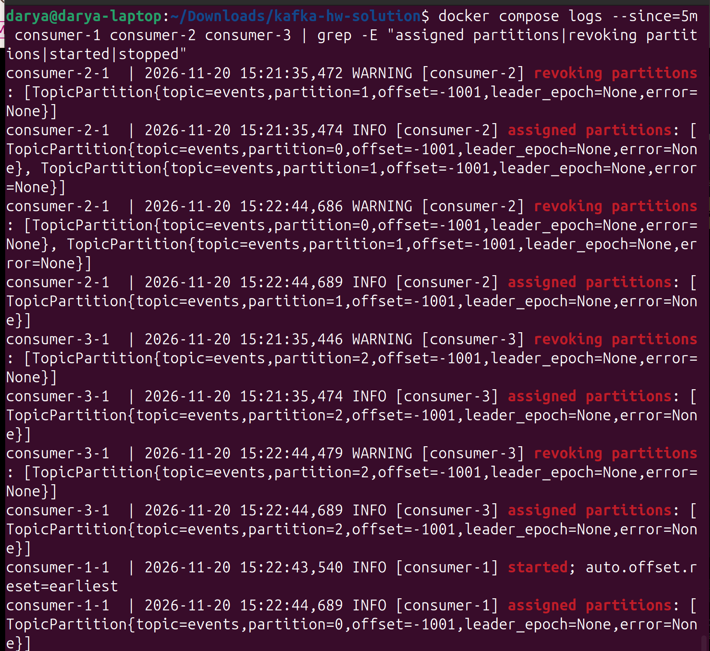
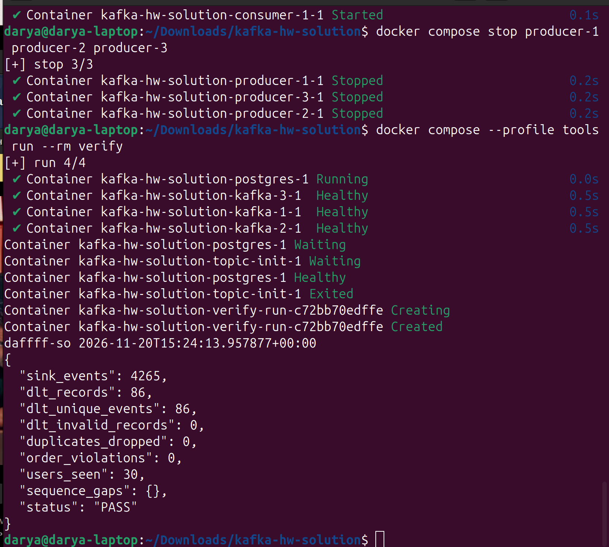
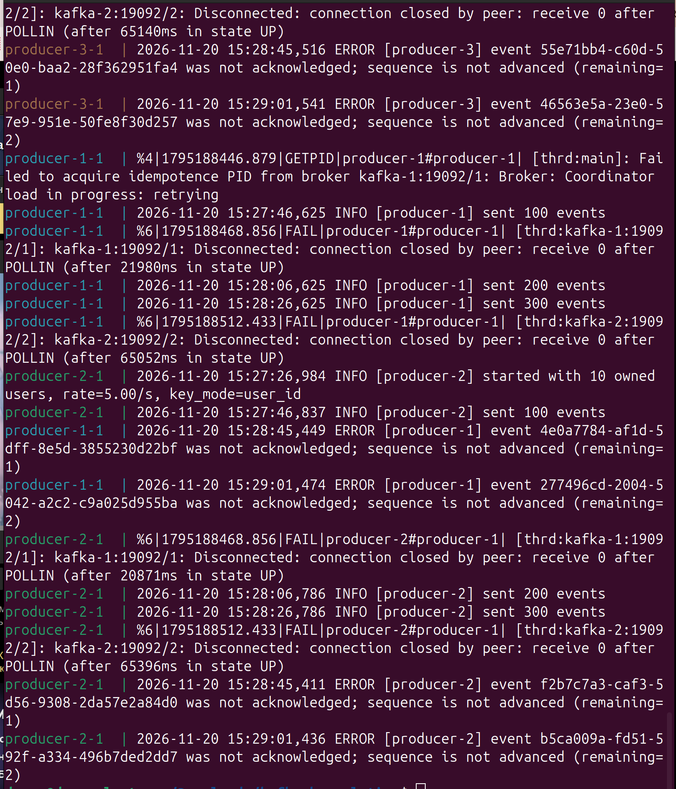
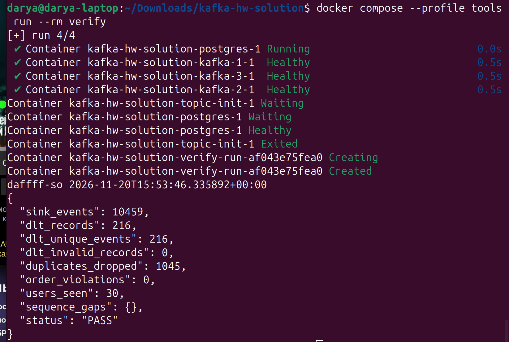
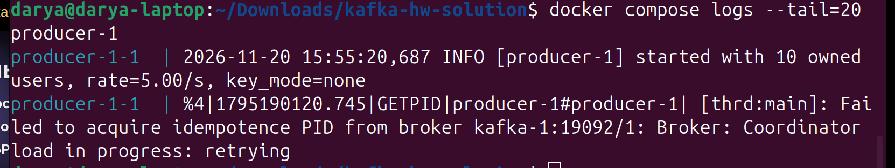
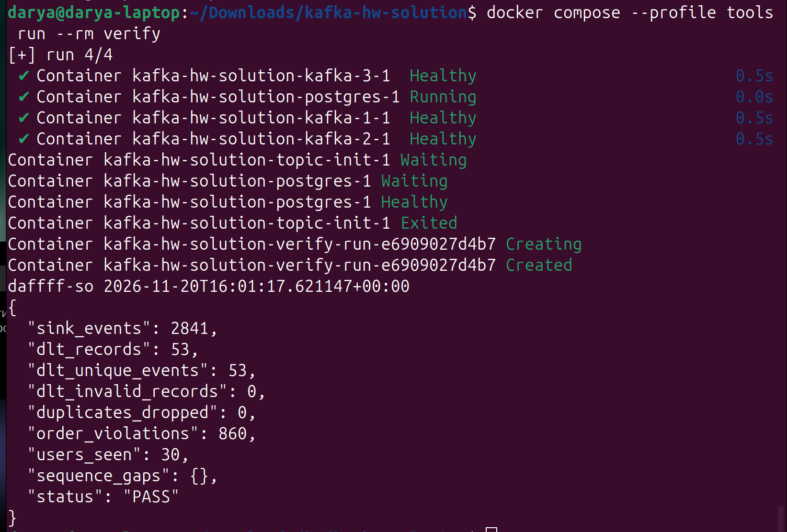

# Kafka: очередь событий, отказы и at-least-once

**Студент:** Дарья Созинова  
**Группа:** М4228  
**Направление:** ФиБ  
**GitHub:** `daffff-so`

Готовый стенд для домашней работы DDIA HW2/3:

- 3 брокера Kafka 4.4.0 в режиме KRaft, без ZooKeeper;
- топики `events` и `events.dlt`, по 3 партиции и с replication factor 3;
- 3 продюсера с `acks=all` и идемпотентностью;
- consumer group `events-processor` из 3 консьюмеров;
- PostgreSQL как общий sink;
- ручной commit только после записи в sink или надёжной отправки в DLT;
- дедупликация по `event_id` и CLI-проверка `verify`.

## Быстрый запуск

Нужны Docker Compose и не менее 4–6 ГБ свободной памяти.

```bash
cp .env.example .env
# В .env обязательно замените GITHUB_LOGIN.
docker compose up -d --build
docker compose ps
docker compose logs -f --tail=100 producer-1 consumer-1
```

Первый запуск занимает несколько минут: скачиваются образы, поднимается quorum и создаются топики. `topic-init` должен завершиться с кодом `0`; это ожидаемое поведение одноразового сервиса.

Проверить топики с хоста:

```bash
docker compose exec kafka-1 /opt/kafka/bin/kafka-topics.sh \
  --bootstrap-server kafka-1:19092 --describe
```

Перед финальной проверкой остановите генерацию и дайте консьюмерам дочитать очередь:

```bash
docker compose stop producer-1 producer-2 producer-3
docker compose exec kafka-1 /opt/kafka/bin/kafka-consumer-groups.sh \
  --bootstrap-server kafka-1:19092 --group events-processor --describe
docker compose --profile tools run --rm verify
```

В столбце `LAG` должны быть нули. Первая строка `verify` содержит GitHub-логин и текущее время. В итоговом JSON:

- `sequence_gaps` должен быть пустым;
- `duplicates_dropped` показывает повторные доставки, подавленные sink;
- `order_violations` показывает случаи, когда меньший `seq` записан позже большего;
- `dlt_unique_events` — число уникальных ядовитых событий;
- `status` должен быть `PASS`.

## Модель события

```json
{
  "event_id": "c5ae0ff5-...",
  "user_id": "user-01-004",
  "type": "page_view",
  "seq": 17,
  "produced_at": "2026-11-20T12:34:56.000000+00:00",
  "payload": {
    "poison": false,
    "producer_id": "producer-1"
  }
}
```

Каждый продюсер владеет отдельным набором `user_id`. Счётчики `seq` сохраняются в отдельном volume каждого продюсера. `event_id` детерминирован по продюсеру, пользователю и `seq`: повторная отправка после аварии не создаёт новую логическую запись.

По умолчанию ключ Kafka равен `user_id`, поэтому все события пользователя попадают в одну партицию. Для эксперимента значение меняется через `KEY_MODE=none`.

Около 2% событий получают `payload.poison=true`. Консьюмер делает три попытки, отправляет исходное событие в `events.dlt` с заголовками `error-reason`, `original-topic`, `original-partition`, `original-offset`, и лишь после подтверждения DLT коммитит исходный offset.

## Почему обработка at-least-once

Автокоммит и автоматическое сохранение offset отключены. Порядок действий консьюмера:

1. прочитать событие;
2. записать его в PostgreSQL;
3. сохранить и синхронно закоммитить следующий offset.

Если процесс погибнет между шагами 2 и 3, событие придёт повторно. Первичный ключ `processed_events.event_id` подавит дубль, а счётчик `duplicates_dropped` увеличится. Параметр `COMMIT_DELAY_MS=100` делает это окно заметным в учебном эксперименте.

`auto.offset.reset=earliest` выбран осознанно: новая группа должна обработать уже накопленные события, а не начать только с новых.

## Эксперимент 1: авария консьюмера

Сначала запишите в отчёте свою гипотезу. Удобная проверяемая формулировка: после `kill -9` координатор группы обнаружит пропажу участника, назначит его партицию оставшимся консьюмерам, а обработка продолжится с последнего закоммиченного offset. Возможна повторная доставка, но не потеря.

```bash
docker compose logs -f consumer-1 consumer-2 consumer-3
# Во втором терминале:
docker compose kill -s SIGKILL consumer-1
docker compose up -d consumer-1
```

После эксперимента остановите продюсеры, дождитесь `LAG=0` и запустите `verify`. Для README достаточно одного скриншота ребаланса и одного скриншота результата `verify`.

## Эксперимент 2: остановка брокеров

Ожидание для одного остановленного брокера: лидеры недоступных партиций будут перевыбраны из ISR, кластер продолжит работу при двух синхронных репликах. После остановки второго брокера останется меньше `min.insync.replicas=2`; продюсеры с `acks=all` не смогут подтверждать новые записи и будут повторять отправку. После возврата брокеров система должна продолжить работу.

```bash
docker compose stop kafka-1
docker compose logs -f kafka-2 kafka-3 producer-1 consumer-1
docker compose stop kafka-2
docker compose start kafka-1 kafka-2
```

Проверка лидеров и ISR:

```bash
docker compose exec kafka-3 /opt/kafka/bin/kafka-topics.sh \
  --bootstrap-server kafka-3:19092 --describe --topic events
```

После восстановления снова дождитесь `LAG=0` и запустите `verify`.

## Эксперимент 3: сообщения без ключа

Для чистого сравнения каждый вариант лучше запускать на пустых volumes и сохранять вывод `verify` отдельно.

Вариант с ключом:

```bash
docker compose down -v
KEY_MODE=user_id docker compose up -d --build
```

Вариант без ключа:

```bash
docker compose down -v
KEY_MODE=none docker compose up -d --build
```

Без ключа события одного пользователя распределяются по разным партициям. Партиции обрабатываются параллельно разными консьюмерами, поэтому глобальный порядок одного пользователя больше не гарантирован и `order_violations` обычно растёт. С ключом все события пользователя идут через одну партицию и сохраняют порядок.

## Результаты экспериментов

Все проверки выполнялись после остановки продюсеров и уменьшения consumer lag до нуля.

### 1. Аварийное завершение консьюмера

**Гипотеза.** После `SIGKILL` координатор consumer group обнаружит исчезновение участника и перераспределит его партицию между оставшимися консьюмерами. Обработка продолжится с последнего закоммиченного offset. Возможна повторная доставка, но потеря событий не ожидается благодаря at-least-once и дедупликации по `event_id`.

**Результат.** После остановки `consumer-1` оставшиеся участники отдали и заново получили партиции. После возвращения `consumer-1` произошёл второй ребаланс. Итоговая проверка обработала 4265 обычных и 86 ядовитых событий; `sequence_gaps={}`, `order_violations=0`, статус `PASS`. В этом запуске авария не попала в короткое окно между записью в sink и commit offset, поэтому `duplicates_dropped=0`.





### 2. Последовательная остановка двух брокеров

**Гипотеза.** При остановке одного брокера кластер останется доступен: лидеры будут выбраны из ISR, а две синхронные реплики удовлетворяют `min.insync.replicas=2`. После остановки второго брокера продюсеры с `acks=all` не смогут получить подтверждение записи. После возврата брокеров клиенты должны продолжить работу; повторные доставки будут подавлены sink.

**Результат.** С одним отключённым брокером обработка продолжалась. После остановки второго брокера продюсеры сообщили `event was not acknowledged` и не увеличивали `seq` неподтверждённых событий. После восстановления брокеров consumer group дочитала очередь. `verify` показал 10459 событий в sink, 216 событий в DLT, 1045 отброшенных повторных доставок, отсутствие пропусков и `PASS`.





### 3. Сравнение ключа `user_id` и отсутствующего ключа

**Гипотеза.** При ключе `user_id` все события пользователя попадают в одну партицию и сохраняют порядок. Без ключа события распределяются между разными партициями, которые параллельно обрабатывают разные консьюмеры; поэтому меньший `seq` может быть записан позже большего.

**Результат.** В базовом запуске с `KEY_MODE=user_id` получено `order_violations=0`. В чистом запуске с `KEY_MODE=none` продюсер подтвердил выбранный режим, а `verify` обнаружил 860 нарушений порядка при пустом `sequence_gaps` и статусе `PASS`. Гипотеза подтвердилась.





## Полезные команды

```bash
docker compose ps
docker compose logs -f --tail=100
docker compose --profile tools run --rm verify
docker compose down
docker compose down -v   # удалить Kafka, PostgreSQL и состояние seq
```

## Что приложить к сдаче

- этот репозиторий и запускаемый `docker-compose.yaml`;
- README с вашей гипотезой и фактическим результатом каждого эксперимента;
- не более двух выразительных скриншотов на эксперимент;
- для DevOps/ФиБ — скринкаст до одной минуты и PR по правилам задания;
- для MSE/MHS — отправка решения в Google Classroom.

Перед защитой необходимо понимать выбор ключа и числа партиций, стратегию commit offset, устройство повторов и DLT, а также причину результатов каждого эксперимента.
